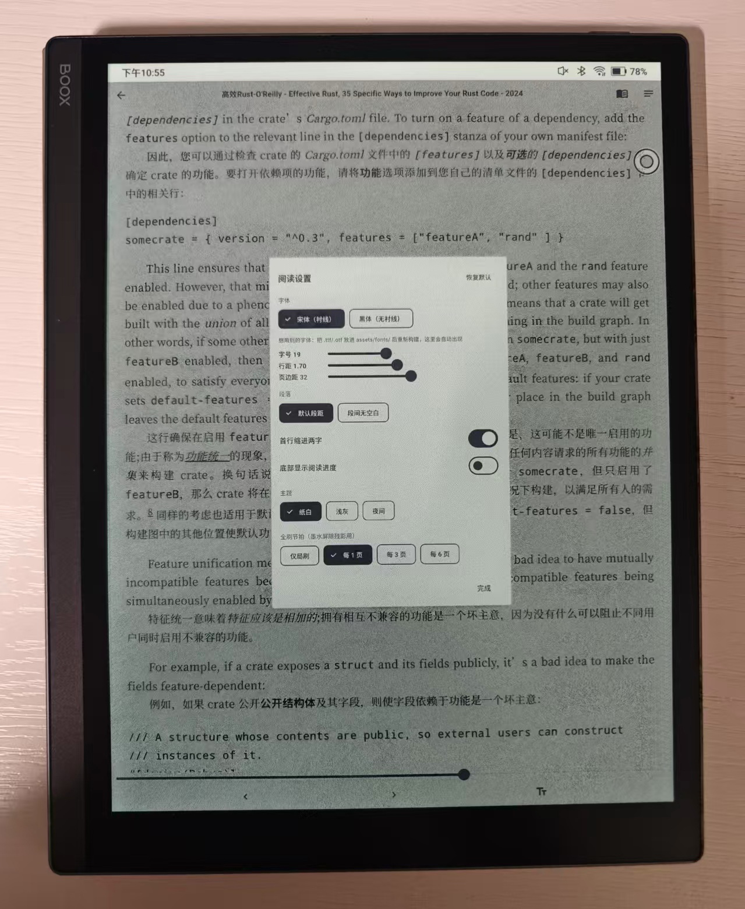

# 墨屏阅读 · Ink Folio

**English | [简体中文](README.zh-CN.md)**

墨屏阅读 (Ink Folio) is an ebook reader designed specifically for e-ink (墨水屏) devices. Import TXT and EPUB books, read with instant page turns, highlight passages and keep notes — everything rendered in clean grayscale with zero animations, so the screen stays free of ghosting and flicker artifacts. It runs on Android and works out of the box on Boox, Hisense and Moaan readers with proper full/partial screen refresh, and silently falls back to normal rendering on any other device.

**Key highlights**

- Purpose-built reading experience for e-ink displays — no animations, no transitions, no visual noise
- Bookshelf with permission-free book import, table of contents, and precise reading progress restore
- Long-press highlighting and notes, kept across restarts, with a global notes view
- Tuned screen refresh control to minimize flicker on e-ink hardware
- Adjustable font size, line height, grayscale themes and custom fonts

## On real hardware



*Running on a BOOX e-ink reader: bilingual book typography with the reading-settings panel open — serif/sans font, font size, line height, page margins, paragraph spacing, first-line indent, paper/light/night grayscale themes and the "full refresh every N pages" cadence. Everything applies instantly, no animations.*

<details>
<summary>Architecture (L1–L5)</summary>

```
L1  Flutter Shell (Dart)      Bookshelf / Settings / Notes / Reader container
L2  Bridge Layer              MethodChannel (EPD) + JS Handlers (unified JSON envelope)
L3  WebView Engine (TS)       in-house EPUB/TXT engine: parsing / pagination / themes / gestures / highlights
L4  Android Native (Kotlin)   EpdRefreshPlugin (Boox / Hisense / Moaan reflection adapters)
L5  Data Layer                sqflite library + sandbox files + shared_preferences
```

</details>

## Features

- **E-ink first**: grayscale-only theme, zero-duration page transitions, no animations, glows, gradients or shadows — ghosting avoided by design.
- **Full/partial EPD refresh**: page turns trigger a full refresh on real e-ink hardware; configurable "full refresh every N pages" for flicker-sensitive devices.
- **TXT & EPUB**: a build-free fallback TXT engine ships in the repo; run one script to build the full in-house EPUB engine (runtime dependency: npm jszip only).
- **Annotations**: long-press selection → highlight/note, persisted and restored across restarts; global notes list.
- **Reading progress**: TXT and EPUB share one model — global character offset + percentage (no CFI).
- **Built-in fonts**: drop Source Han Serif/Sans into `assets/fonts/` — `FontManager` copies them to the sandbox and exposes them to the engine via `@font-face`.
- **SAF book import**: no storage permissions required.

## Requirements

- Flutter ≥ 3.19 (Dart ≥ 3.3)
- Android SDK 34, minSdk 23 (covers common older Boox/Hisense/Moaan models)
- Node ≥ 18 + npm/pnpm (only for building the EPUB engine)

## Quick Start

### 1. Run without building the engine (works out of the box)

The repo ships a build-free fallback engine (`assets/web/main.js`, vanilla JS, TXT only):

```bash
flutter pub get
flutter run -d <android-device>   # real device / emulator
flutter run -d chrome             # Chrome debugging (shell + TXT only, see Platform Notes)
```

A sample book with 8 chapters is preloaded on the shelf to verify pagination, TOC, progress restore, highlights and theme switching end to end.

### 2. Enable the EPUB engine (build the TS bundle)

```bash
# Windows
.\build_web.ps1
# Linux/macOS
./build_web.sh
```

The script runs `cd web_engine && install && build` and copies the output into `assets/web/`, overriding the fallback engine. Re-run the app to get EPUB support.

### 3. Build the APK

```bash
flutter build apk --release
# output: build/app/outputs/flutter-apk/app-release.apk
```

> If the first build fails on the Gradle wrapper (the repo doesn't include `gradle-wrapper.jar`), run `flutter create --platforms=android .` in the project root to regenerate the scaffolding — existing files are not overwritten. Note that this **will** overwrite the native e-ink customization files under `android/`; see `AGENTS.md` before rebuilding.

### One-shot bootstrap

`.\init.ps1` (Windows) regenerates missing platform folders, runs `pub get`, `flutter analyze` and `flutter test`.

## Project Layout

```
├── android/                        # L4: gradle + EpdRefreshPlugin.kt + MainActivity.kt
├── assets/
│   ├── web/                        # engine output (currently the fallback TXT engine)
│   ├── books/sample.txt            # preloaded sample book
│   └── fonts/                      # drop-in directory for bundled fonts (optional)
├── lib/
│   ├── main.dart / app.dart        # entry + grayscale ThemeData + instant routes
│   ├── bridge/                     # JSON envelope, Dart↔TS bridge, EPD MethodChannel
│   ├── features/
│   │   ├── shelf/                  # bookshelf (import / delete / placeholder covers)
│   │   ├── reader/                 # reader page + controller + chrome/TOC/highlight menu
│   │   ├── settings/               # font size / line height / theme / font / refresh rate
│   │   └── annotation/             # global notes list
│   ├── data/                       # models / sqflite / dual-platform repositories
│   ├── services/                   # book import / font manager / web asset copying
│   ├── core/ & theme/              # shared helpers + grayscale theme & zero-duration routes
├── web_engine/                     # L3: TypeScript engine (Vite + jszip)
├── build_web.sh / build_web.ps1    # build the engine into assets/web/
└── pubspec.yaml
```

## Bridge Protocol (Dart ↔ TS)

Unified envelope: `{ action, payload, requestId? }`.
Dart→TS: `window.__reader.dispatch(msg)`; TS→Dart: `callHandler('event', msg)`.

| Dir | Name | Payload | Purpose |
|---|---|---|---|
| ↓ | openBook | `{bookId, kind, filePath, text?, cfi?, start?, highlights?}` | open a book; TXT content may be inlined (required on web) |
| ↓ | applyTheme | `{mode, fontSize, lineHeight, fontFamily, fontPath?}` | live theme/font changes |
| ↓ | scrollToPercent / scrollToOffset / scrollToCfi | `{percent}` / `{start}` / `{cfi}` | navigation |
| ↓ | nextPage / prevPage | `{}` | page turn |
| ↓ | addAnnotation / removeAnnotation | `{id, start?, end?, cfiRange?, color}` / `{id}` | highlight rendering |
| ↓ | exportAnnotations | `{}` | request current annotations back |
| ↑ | onReady / onMeta / onToc | — / `{title, author}` / `{items:[...]}` | handshake, metadata, TOC |
| ↑ | onPageChanged | `{percent, cfi?, start?, chapter?, index, total}` | page rendered (Dart saves progress + triggers full refresh) |
| ↑ | onLongPress | `{text, start?, end?, cfiRange?}` | selection → Flutter highlight menu |
| ↑ | onToggleChrome | — | center tap → show/hide top/bottom bars |
| ↑ | onNeedRefresh | `{type: 'full'\|'partial'}` | EPD refresh request |

**Critical ordering (do not invert)**: TS finishes rendering → `onPageChanged` → Dart `EpdChannel.full()` → native full refresh.

## EPD Refresh Plugin (L4)

Vendors expose no unified public API, so `EpdRefreshPlugin.kt` uses a "candidate classes + reflection + try each" strategy:

- **Boox/Onyx**: `com.onyx.android.sdk.device.EpdController` / `EpdDeviceManager` / `DeviceInfoSingleton`
- **Hisense**: `com.hisense.epd.Epd` / `com.hisense.android.graphics.EPDManager`
- **Moaan**: shares the Boox candidates (same kernel lineage), falls back to the generic path
- **Generic fallback**: `decorView.invalidate()` (behaves like a partial refresh by default)
- `isEink()` whitelist-matches `Build.MANUFACTURER`; on non-e-ink devices the Dart side goes silent automatically.

If you obtain an official vendor AAR SDK, replace the reflection branch in `resolveEntry()` — the Dart protocol stays unchanged. Reflection adapters must be verified on real devices (emulators have no EPD controller).

## Platform Notes

1. **Web (Chrome)**: uses a same-origin iframe loading `assets/web/index.html`, talking to Dart over `postMessage`. Both TXT and EPUB work: TXT content is passed inline, EPUB bytes are read by Dart and shipped as `dataBase64` (there is no readable sandbox path on web; the blob lives in memory, so **re-import after a page reload**). sqflite is unavailable on web — the `Repositories` factory automatically switches to SharedPreferences + in-memory implementations.
2. **EPUB engine**: in-house implementation (JSZip for zip + native DOMParser for OPF/NCX/NAV) — no third-party black box; key calls are wrapped in try/catch so engine failures never take down the shell — errors surface through the `onError` event.
3. **Binaries not in the repo**: `gradle-wrapper.jar` (regenerate with `flutter create .`), font files (drop into `assets/fonts/`), vendor EPD AARs (as needed).

## Development

```bash
flutter analyze        # static analysis
flutter test           # smoke test (uses Repositories.overrideForTest(), no platform plugins needed)
cd web_engine && npm run build   # TS engine build (includes tsc --noEmit)
```

Key conventions (see `AGENTS.md` for the full list):
- The Dart package name is `ebook_reader` (not the repo name) — all imports use `package:ebook_reader/...`.
- E-ink principle: **no animations anywhere** (themes/routes use `Duration.zero`), overscroll glow disabled globally.

## Documentation

- [SETUP.md](SETUP.md) — full English setup & verification checklist (中文版：[SETUP.zh-CN.md](SETUP.zh-CN.md))
- [AGENTS.md](AGENTS.md) — architecture boundaries and development conventions
- [web_engine/README.md](web_engine/README.md) — TypeScript engine details
- [简体中文 README](README.zh-CN.md) — this document in Chinese
